# XDI Alerting Pipeline: System Design, ADRs & Implementation Plan

This document outlines the architecture, technical trade-offs (ADRs), and step-by-step build plan for replicating the **Telstra XDI (Cross Domain Intelligence) Alerting Pipeline**:

> *"Owned the alerting pipeline behind the XDI node dashboard: wrote ksqlDB streaming queries over Kafka alert topics and built Python/PySpark jobs that deduplicated, cleaned, and aggregated alerts into Delta Lake using the medallion architecture (bronze, silver, gold), serving pre-aggregated per-node alerts for 7-day, 30-day, 365-day, and custom-range views on node selection."*

---

## 1. High-Level System Design

```mermaid
flowchart LR
    subgraph Source["1. Telemetry & Chaos Producer"]
        HF["Hugging Face Parquet (Telecom Event Logs)"]
        PROD["producer.py (Injects noise, duplicates & dirty rows)"]
        HF --> PROD
    end

    subgraph Broker["2. Event Backbone & Hot Path (Docker)"]
        RAW_TOPIC[("Kafka Topic: telecom.events.raw")]
        KSQL_FILTER["ksqlDB STREAM: Filters noise & routes alerts"]
        KSQL_LIVE[("ksqlDB TABLE: live_node_alerts_5m (15m TTL eviction)")]
        ALERT_TOPIC[("Kafka Topic: telecom.alerts.raw")]

        PROD -->|"Raw JSON"| RAW_TOPIC
        RAW_TOPIC --> KSQL_FILTER
        KSQL_FILTER -->|"Hot Path (5m Window)"| KSQL_LIVE
        KSQL_FILTER -->|"Valid Alerts"| ALERT_TOPIC
    end

    subgraph Lakehouse["3. PySpark Structured Streaming + Delta Lake on SeaweedFS (s3a://lakehouse)"]
        BRONZE[("Bronze Delta Table (Raw Append-Only)")]
        SILVER[("Silver Delta Table (Cleaned & Deduplicated)")]
        GOLD_DAILY[("Gold Daily Node Table (Custom Date Ranges)")]
        GOLD_ROLLING[("Gold Rolling Windows (7d / 30d / 365d)")]

        ALERT_TOPIC -->|"Spark Kafka Stream"| BRONZE
        BRONZE -->|"Delta Stream"| SILVER
        SILVER -->|"MERGE Upsert"| GOLD_DAILY
        GOLD_DAILY -->|"Window Rollup"| GOLD_ROLLING
    end

    subgraph Consumer["4. XDI Node Dashboard Query Layer"]
        QUERY["dashboard_query.py (Fast lookup by node_id)"]
        KSQL_LIVE -->|"Live Now Status"| QUERY
        GOLD_DAILY -->|"Custom Range"| QUERY
        GOLD_ROLLING -->|"7d / 30d / 365d"| QUERY
    end
```



### Target Repository Structure
```text
telecom-alert-pipeline/
├── docker-compose.yml          # Kafka 3.9 (KRaft), ksqlDB (Server + CLI), SeaweedFS (S3)
├── mise.toml                   # Java 21 (Temurin) + Python 3.13 + auto .venv
├── requirements.txt            # pyspark 4.2, delta-spark 4.4, confluent-kafka, pyarrow
├── docs/
│   └── ARCHITECTURE.md         # System design, schema contracts & ADRs
├── data/
│   └── raw_telecom_events.parquet
├── ksql/
│   └── init_streams.sql        # ksqlDB STREAM filtering & 5m hopping window TABLE
└── src/
    ├── config.py               # Spark + Delta Lake + SeaweedFS (s3a://) session builder
    ├── download_data.py        # Pulls Hugging Face telecom dataset locally
    ├── producer.py             # Streams events to Kafka (with noise, duplicates & errors)
    ├── bronze_stream.py        # Kafka -> Bronze Delta on SeaweedFS S3
    ├── silver_stream.py        # Bronze -> Silver Delta (watermark deduplication & cleaning)
    ├── gold_aggregation.py     # Silver -> Gold Delta (7d, 30d, 365d & custom-range rollups)
    └── dashboard_query.py      # CLI/script querying ksqlDB (live) + Gold Delta (historical)
```

---

## 2. Data Source & Medallion Schema Contracts

### 2.1 Source Dataset Overview
* **Dataset:** [`electricsheepafrica/africa-synth-telecom-network-event-logs-nigeria`](https://huggingface.co/datasets/electricsheepafrica/africa-synth-telecom-network-event-logs-nigeria) (Hugging Face)
* **Format & Volume:** Apache Parquet, ~100,000+ telecom network event/alert logs.
* **Domain Mapping to XDI:** Each telecom tower (`tower_id`) represents a physical network routing node (`node_id`) on the XDI dashboard, emitting discrete fault/alert events over time.

#### Source Field Dictionary
| Source Field | Type | Sample Value | XDI Pipeline Role |
| :--- | :--- | :--- | :--- |
| `event_id` | `string` | `"EVT00000001"` | Unique alert identifier. Used as the primary deduplication key in **Silver**. |
| `timestamp` | `string` (ISO-8601) | `"2025-09-26T23:10:04"` | Event occurrence time on the hardware. Parsed to `TIMESTAMP` for watermarking and date rollups. |
| `tower_id` | `string` | `"IBA-1270"` | Network Node ID (`node_id`). Used as the **Kafka message key** and **Gold** grouping key. |
| `city` | `string` | `"Ibadan"` | Geographic region/site metadata for the node. |
| `event_type` | `string` | `"congestion"` | Fault category (e.g., `congestion`, `packet_loss`, `handover_failure`, `link_down`). |
| `severity` | `string` | `"low"` | Alert criticality (`low`, `medium`, `high`, `critical`). Normalized and pivoted into counts in **Gold**. |
| `affected_users` | `int64` | `33` | Impact metric: number of active sessions/users impacted by the alert. |
| `packet_loss_percent` | `float64` | `0.0` | Telemetry metric (`0.0`–`100.0`). Used for average and peak packet loss aggregations. |
| `network_type` | `string` | `"4G"` | Radio/transport generation (`3G`, `4G`, `5G`). |
| `operator` | `string` | `"9mobile"` | Carrier / network domain identifier. |

### 2.2 Synthetic Chaos Injection (Why the Producer Injects Dirty Data)
Because the Hugging Face Parquet file is relatively clean static data, `producer.py` intentionally injects three real-world streaming anomalies before publishing to Kafka:
1. **~5% Duplicate Events:** Re-emits a recently sent `event_id` a few seconds later to simulate *at-least-once* retry duplicates from network collectors.
2. **~2% Dirty / Unnormalized Values:** Uppercase/mixed-case severities (e.g., `"CRITICAL "`, `"High"`), out-of-range metrics (`packet_loss_percent: -5.0` or `150.0`), or missing `tower_id`.
3. **~1% Malformed JSON:** Truncated JSON payloads to verify **Bronze** captures raw strings without crashing the stream and **Silver** safely isolates corrupt records.

### 2.3 Schema Evolution Across Medallion Layers

```mermaid
erDiagram
    BRONZE_ALERTS {
        string kafka_key "Decoded tower_id key"
        string raw_payload "Unparsed JSON string"
        string topic "Kafka topic name"
        int partition "Kafka partition index"
        long offset "Kafka partition offset"
        timestamp kafka_timestamp "Broker ingestion time"
        timestamp ingested_at "Spark Bronze write time"
    }

    SILVER_ALERTS {
        string event_id PK "Deduplicated within watermark"
        timestamp event_timestamp "Parsed event timestamp"
        date alert_date "Partition key derived from timestamp"
        string node_id "Renamed from tower_id"
        string city "Trimmed location string"
        string event_type "Normalized lowercase fault type"
        string severity "Normalized low medium high critical"
        int affected_users "Clamped non-negative integer"
        double packet_loss_percent "Clamped 0.0 to 100.0"
        string network_type "Radio generation 3G 4G 5G"
        string operator "Carrier domain"
        timestamp processed_at "Silver transformation time"
    }

    GOLD_NODE_DAILY_SUMMARY {
        string node_id PK "Network node identifier"
        date alert_date PK "Calendar day UTC"
        string city "Node location"
        long total_alerts "Count of deduplicated alerts"
        long critical_alerts "Count of critical severity"
        long high_alerts "Count of high severity"
        long medium_alerts "Count of medium severity"
        long low_alerts "Count of low severity"
        long total_affected_users "Sum of affected_users"
        double avg_packet_loss "Average packet_loss_percent"
        double max_packet_loss "Peak packet_loss_percent"
        timestamp updated_at "Last Gold merge time"
    }

    GOLD_NODE_ROLLING_WINDOWS {
        string node_id PK "Network node identifier"
        string window_preset PK "Preset 7d 30d or 365d"
        date window_start_date "Start date of rolling window"
        date window_end_date "Reference anchor date"
        long total_alerts "Sum of alerts in window"
        long critical_alerts "Sum of critical alerts"
        long high_alerts "Sum of high alerts"
        long medium_alerts "Sum of medium alerts"
        long low_alerts "Sum of low alerts"
        long total_affected_users "Sum of affected_users"
        double avg_packet_loss "Weighted avg packet loss"
        double max_packet_loss "Max packet loss in window"
        timestamp updated_at "Last rollup refresh time"
    }

    BRONZE_ALERTS ||--o{ SILVER_ALERTS : "parses and deduplicates"
    SILVER_ALERTS ||--o{ GOLD_NODE_DAILY_SUMMARY : "aggregates by node and date"
    GOLD_NODE_DAILY_SUMMARY ||--o{ GOLD_NODE_ROLLING_WINDOWS : "rolls up 7d 30d 365d windows"
```



| Layer / Table | Primary / Clustering Keys | Columns & Transformations |
| :--- | :--- | :--- |
| **`bronze_alerts`** | Append-only (`partition`, `offset`) | `kafka_key` (`string`), `raw_payload` (`string`), `topic` (`string`), `partition` (`int`), `offset` (`long`), `kafka_timestamp` (`timestamp`), `ingested_at` (`timestamp`) |
| **`silver_alerts`** | `event_id` (deduplicated within 1h watermark), partitioned by `alert_date` | `event_id` (`string`), `event_timestamp` (`timestamp`), `alert_date` (`date`), `node_id` (`string`, from `tower_id`), `city` (`string`), `event_type` (`string`), `severity` (`low` \| `medium` \| `high` \| `critical`), `affected_users` (`int >= 0`), `packet_loss_percent` (`double 0..100`), `network_type` (`string`), `operator` (`string`), `processed_at` (`timestamp`) |
| **`gold_node_daily_summary`** | `(node_id, alert_date)` | `node_id`, `alert_date`, `city`, `total_alerts`, `critical_alerts`, `high_alerts`, `medium_alerts`, `low_alerts`, `total_affected_users`, `avg_packet_loss`, `max_packet_loss`, `updated_at` |
| **`gold_node_rolling_windows`** | `(node_id, window_preset)` where preset $\in$ `7d`, `30d`, `365d` | `node_id`, `window_preset`, `window_start_date`, `window_end_date`, `total_alerts`, `critical_alerts`, `high_alerts`, `medium_alerts`, `low_alerts`, `total_affected_users`, `avg_packet_loss`, `max_packet_loss`, `updated_at` |

---

## 3. Architecture Decision Records (ADRs)

### ADR-001: Medallion Architecture on Delta Lake
* **Context:** Network hardware emits high-volume, bursty alert streams that occasionally contain malformed payloads or duplicate retries from upstream collectors. If we aggregate directly from Kafka into a database, a bug in parsing logic or a poison pill loses data or corrupts downstream metrics.
* **Decision:** Use a 3-tier **Medallion Architecture** (`Bronze` $\rightarrow$ `Silver` $\rightarrow$ `Gold`) backed by **Delta Lake**:
  * **Bronze:** Stores the raw Kafka payload (`value` as string) plus Kafka metadata (`topic`, `partition`, `offset`, `kafka_timestamp`, `ingested_at`). No rows are dropped here, enabling full replayability.
  * **Silver:** Parses JSON, standardizes schemas/types (`timestamp`, normalized `severity`), filters invalid records, and deduplicates events by `event_id`.
  * **Gold:** Pre-computes per-node (`tower_id`) aggregations optimized for the XDI dashboard's exact access patterns.
* **Consequence:** Slightly higher storage footprint (3 copies of data at different grains), traded for ACID transactions, time-travel debugging, and zero data loss if business rules change.

---

### ADR-002: Partitioning Kafka by `tower_id` & Watermarked Deduplication
* **Context:** Upstream network probes use *at-least-once* delivery, producing duplicate `event_id` records when network acks time out. However, in a 24/7 stream, keeping every `event_id` ever seen in Spark memory to check for duplicates will eventually cause an `OutOfMemoryError` (OOM).
* **Decision:**
  1. **Kafka Keying:** Key Kafka messages by `tower_id` (node ID) so all alerts for the same routing node land on the same Kafka partition, preserving per-node ordering and reducing Spark shuffle overhead.
  2. **Bounded State via Watermarking:** In Silver (`silver_stream.py`), apply `.withWatermark("event_timestamp", "1 hour").dropDuplicates(["event_id", "event_timestamp"])`.
* **Consequence:** Spark automatically evicts `event_id` keys older than 1 hour of event-time from its RocksDB/memory state store, bounding memory usage while catching retry duplicates within the 1-hour window.

---

### ADR-003: Serving 7d, 30d, 365d & Custom-Range Views via Daily Grain + Rolling Tables
* **Context:** When an engineer clicks a router node on the XDI dashboard, they toggle between **7-day**, **30-day**, **365-day**, or **custom date-range** views. Scanning raw Silver alerts across 365 days on every click is too slow.
* **Decision:** Design two complementary Gold tables partitioned/clustered by `node_id` (`tower_id`):
  1. **`gold_node_daily_summary`:** Aggregated at `(node_id, alert_date)` grain with counts per severity (`critical`, `high`, `medium`, `low`), total `affected_users`, and average/max `packet_loss_percent`. Any **custom date range** (e.g., `2025-05-01` to `2025-06-15`) only scans at most a few dozen pre-aggregated daily rows per node instead of thousands of raw events.
  2. **`gold_node_rolling_windows`:** Materializes exact `7d`, `30d`, and `365d` summary rows per `node_id` for single-row point lookups on the preset dashboard tabs.
* **Consequence:** Sub-second query latency across both fixed presets (`7d`/`30d`/`365d`) and arbitrary custom ranges.

---

### ADR-004: Hybrid Stream Triage (ksqlDB Hot Path) & Lakehouse Storage (Delta Lake on SeaweedFS S3)
* **Context:** The XDI dashboard needs both immediate live visibility ("What nodes are spiking right now in the last 5 minutes?") and deep historical analytics ("Show me node `IBA-1270` over 30 days, 365 days, or a custom window"). Keeping 365 days of raw state in ksqlDB's local RocksDB would exhaust memory, while running Spark batch rollups for 5-minute live counters adds unnecessary latency. Additionally, Delta Lake tables in production must live on shared S3-compatible object storage rather than local disk.
* **Decision:**
  1. **ksqlDB (Stream Filtering & 5m Hot Window):** A persistent ksqlDB `STREAM` filters raw `telecom.events.raw` (dropping routine `heartbeat` noise) and routes actionable alerts into `telecom.alerts.raw`. A ksqlDB windowed `TABLE` (`live_node_alerts_5m`) maintains a 5-minute hopping window in RocksDB with a 15-minute `RETENTION` TTL, automatically evicting expired windows.
  2. **SeaweedFS + Delta Lake (`s3a://lakehouse/`):** **SeaweedFS** runs in Docker exposing an S3 API (`:8333`) and Filer UI (`:8888`). **PySpark** consumes `telecom.alerts.raw` and writes **Delta Lake** tables (`_delta_log/` + `.parquet`) directly to `s3a://lakehouse/{bronze,silver,gold}`.
* **Consequence:** Clean separation between bounded-memory real-time stream processing (ksqlDB) and ACID-compliant historical lakehouse storage (PySpark + Delta Lake on S3).

---

## 4. Step-by-Step Walkthrough Plan

| Step | Module | What We'll Build | Key Concept You'll Learn |
| :--- | :--- | :--- | :--- |
| **Step 1** ✅ | Environment & Infra | `mise.toml` (Java 21 + Python 3.13), `requirements.txt`, `docker-compose.yml` (Kafka KRaft, ksqlDB, SeaweedFS S3) | Why Spark needs a JVM, KRaft vs ZooKeeper, ksqlDB vs Lakehouse, and S3 object storage |
| **Step 2** 🔜 | Data, Producer & ksqlDB | `src/download_data.py`, `src/producer.py`, `ksql/init_streams.sql` | Streaming noisy + duplicate events to Kafka and filtering/windowing them live with ksqlDB |
| **Step 3** | Spark Session & Bronze | `src/config.py` & `src/bronze_stream.py` | Configuring Spark 4 with Kafka + Delta + `hadoop-aws` (`s3a://`) connectors and writing raw Bronze tables to SeaweedFS |
| **Step 4** | Silver Stream | `src/silver_stream.py` | Reading a Delta table as a stream, JSON parsing, data cleaning, and stateful deduplication with `withWatermark` |
| **Step 5** | Gold Aggregations | `src/gold_aggregation.py` | Upserting into Delta Lake (`DeltaTable.merge`) to build `gold_node_daily_summary` (custom ranges) and `gold_node_rolling_windows` (`7d`/`30d`/`365d`) |
| **Step 6** | XDI Query Verification | `src/dashboard_query.py` | Querying ksqlDB (live 5m window) and Gold Delta tables on S3 (`7d`, `30d`, `365d`, and custom ranges) |
